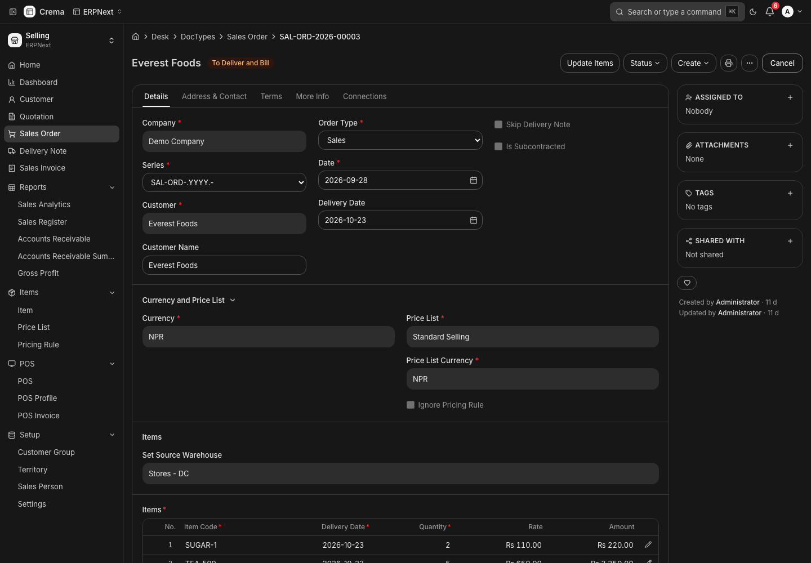
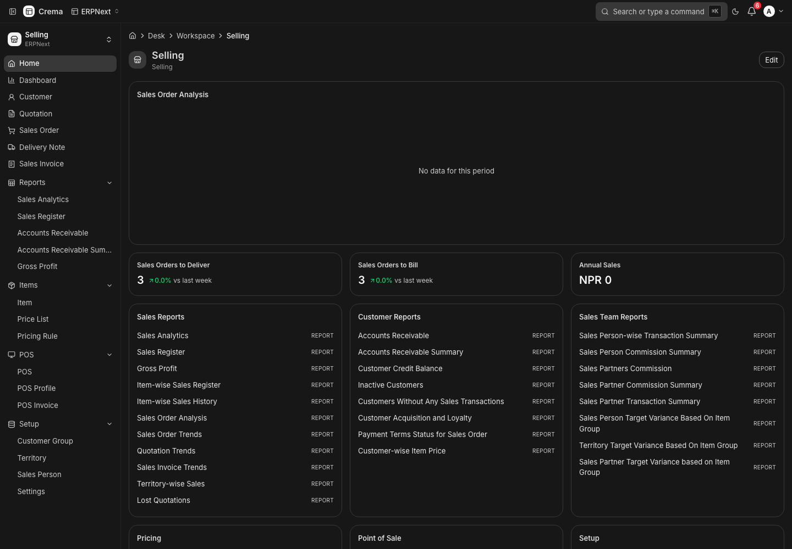
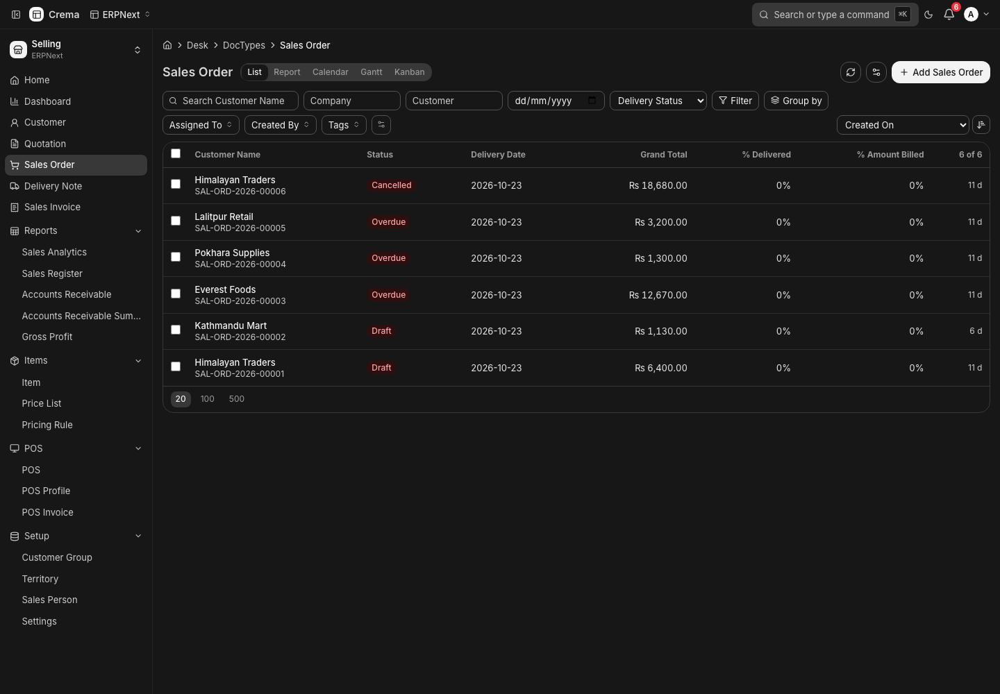
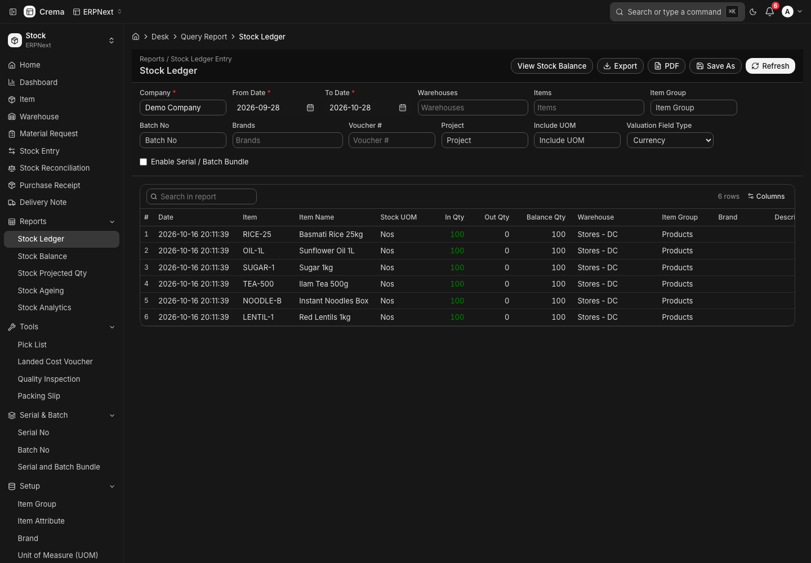
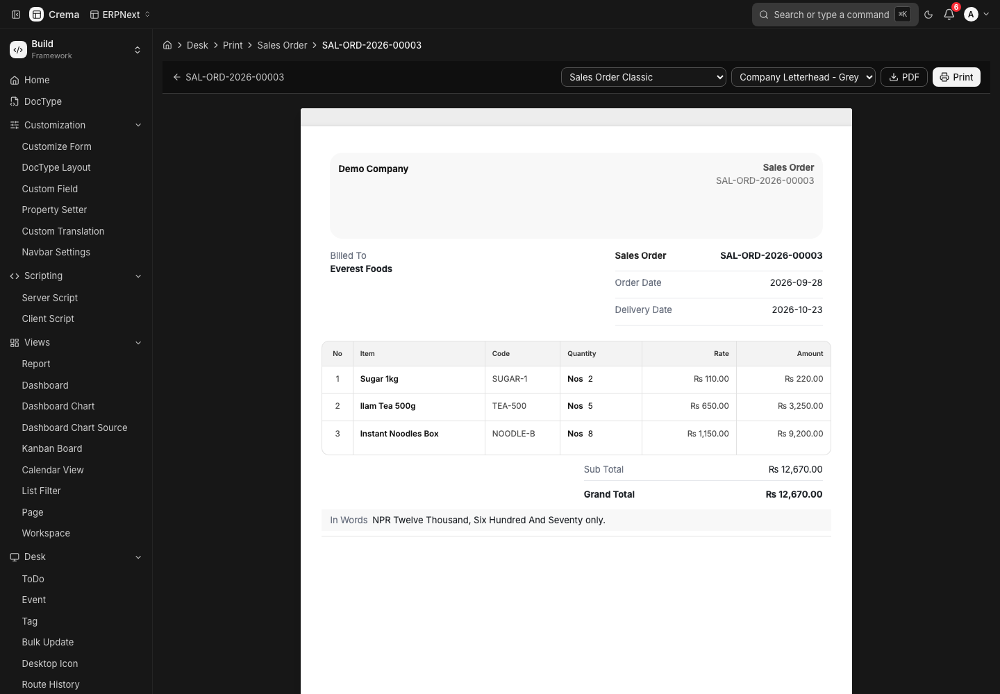
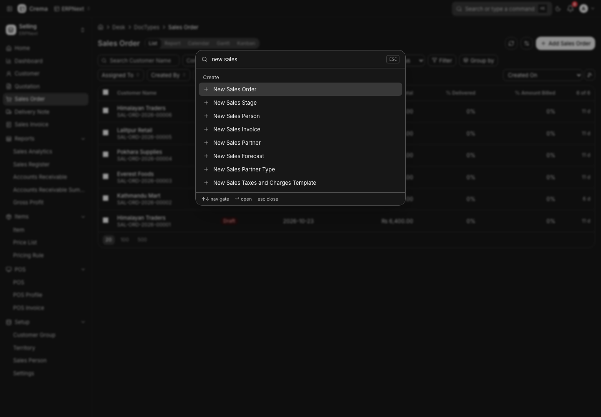

# Crema

**A modern desk for the Frappe framework.** Crema is a Next.js replacement for Frappe Desk that runs against any Frappe v16 site, ERPNext included, with no per-app code. It reads the site's metadata and runs the site's own JavaScript, so the forms, lists, reports and workflows of every installed app keep working.



## Why it matters

Frappe Desk is powerful, but it is built on jQuery-era UI code that is hard to restyle, hard to extend and slow to change. Teams that build on Frappe usually end up choosing between living with Desk or rebuilding screens app by app.

Crema takes a third route:

- **One frontend for every app.** Behaviour comes from DocType metadata, Client Scripts and each app's own form JS. Nothing is hard-coded for ERPNext or any other app, so a custom app gets a modern UI without frontend work.
- **Same data, same rules.** Every action goes through Frappe's own APIs (`savedocs`, `submit`, workflow transitions, permissions). Saving in Crema is the same as saving in Desk, and the server stays the source of truth.
- **Room to grow.** A React 19 / Tailwind 4 codebase can be themed, made mobile-friendly and extended in ways the classic Desk can't easily support.
- **Verified, not assumed.** Each feature is checked by doing the same thing in Desk and in Crema against a live bench, then confirming the result in the database.

## What works today

| Area | Done |
|---|---|
| **Forms** | Save, submit, cancel, amend, delete (an unchanged save sends nothing, like Desk); tabs, sections, `depends_on` / `mandatory_depends_on` / `read_only_depends_on`; quick entry; rename, links, reminders, copy; **field-level permissions** (permlevels hide or lock fields like Desk) |
| **Client scripts** | The real Frappe client-script runtime: `frappe`, `frm`, `cur_frm`, `frappe.ui.Dialog`, `MultiSelectDialog`, real jQuery for scripts that write into the page. ERPNext's own Sales/Purchase Order, Invoice, Delivery Note and Stock Entry scripts run without errors |
| **Child tables** | Add, insert, duplicate, move, drag to reorder, multi-select delete, 50-row pages, CSV download/upload, row forms |
| **Field controls** | Data (with Email/Phone/URL validation), Int, Float, Currency, Percent, Check, Select, Link, Dynamic Link, Date, Datetime, Table, Attach, Attach Image, HTML, Code and Text Editor (rendered rich text), formatted from System Settings. Markdown, JSON, Time, Duration, Rating, Color, Phone, Password, Signature, Barcode, Geolocation and the multi-selects are built and still being verified against Desk |
| **Lists** | Filters, standard filters, group-by sidebar, sort, paging, bulk edit / delete / submit / cancel / print / assign / tag / export, list settings, per-user saved state, realtime refresh |
| **Views** | Report view, Kanban, Calendar, Gantt, Tree, Image, Inbox, File manager, Dashboard |
| **Reports** | Query and Script reports with the report's own JS filters and formatters, tree reports, totals, charts, prepared reports, Report Builder, Save As |
| **Collaboration** | Timeline with comments, @mentions, version diffs and emails; email composer; assign, share, follow, tags, likes; notifications; viewers on the same document |
| **Print** | Print view with format and letterhead pickers, PDF download; create custom Jinja print formats from Crema's own form |
| **Workflows** | Workflow states and actions on the form, read-only states, transitions through Frappe |
| **Workspaces** | Shortcuts, cards, charts, number cards, onboarding blocks, Custom HTML blocks, sidebar |
| **Admin** | Users with Frappe's own user actions, role and module editors, Role Permissions Manager, impersonation with a site banner, Data Import, Customize Form, DocType builder |
| **Shell** | ⌘K awesomebar (records, "new X", calculator, "text in DocType"), keyboard shortcuts, breadcrumbs, user menu, Desk URLs resolved like Desk's router |
| **Errors** | Server messages as toasts; System Managers can open the full server traceback with **Details** |
| **Desk pages** | Any page that isn't rebuilt yet (Point of Sale, Setup Wizard, BOM Comparison, …) opens Frappe's own page inside Crema, with navigation bridged back |
| **ERPNext extras** | Address and contact cards, item stock levels, Serial and Batch selector, accounting and stock ledger previews |

54 end-to-end suites (`crema-frontend/e2e/`) drive a real browser against a live Frappe v16 + ERPNext v16 site and confirm results through the API.

| | |
|---|---|
|  |  |
|  |  |



## How it runs Frappe's JavaScript

Crema doesn't fork app code. It provides the APIs that app code expects, in layers:

| Layer | What it covers | How |
|---|---|---|
| **L1 Metadata UI** | Forms, lists, views, reports | Native React driven by DocType meta; the site's form, list, tree, calendar and report JS plus Client Scripts run in a Desk-compatible runtime |
| **L2 Script DOM** | Scripts that write into the page (`$wrapper.html()`, `frm.dashboard`) | Real jQuery and real DOM nodes for HTML fields and the form dashboard |
| **L3 Desk widgets** | Role editor, module editor, permission manager, ERPNext dialogs | Rebuilt natively, writing to the same child tables and APIs as Desk |
| **L4 Whole pages** | Point of Sale, Setup Wizard and any other Desk page | Frappe's own page in a same-origin frame, with navigation bridged back |

Details and the full feature audit: [`docs/GAPS.md`](docs/GAPS.md).

## What's next

**Finish Desk parity** (the ❌ items in [`docs/GAPS.md`](docs/GAPS.md)), most important first:
- Forms: undo/redo, previous/next document, form tours, success actions, "Not permitted" banners
- Grid: keyboard navigation, pasting rows from a spreadsheet, per-user column settings
- Lists: saved and shared filters, row extras (comment counts, assignees, unread), virtualised lists for large tables
- Views: Map view, Kanban v2, report view group-by with aggregates
- Builders: Print Format Builder, Web Form and Workflow builders verified against Desk
- Mobile layouts and a keyboard-only / accessibility pass

**Ship as a Frappe app.** Package Crema as an installable Frappe app: a static Next.js export served by Frappe at `/desk`, with classic Desk kept at `/app` behind a "Use classic Desk" switch. This removes the separate Node server and the proxy routes. The plan is in [`docs/GAPS.md` § 3](docs/GAPS.md). The System Console and web-form submission screens already call `crema.*` server methods that will live in that app.

**Then, UX.** Once behaviour matches Desk, improve on it: faster navigation, better mobile forms, theming
([`docs/GAPS.md` § 3](docs/GAPS.md)).

**Beyond Desk.** One desk for several Frappe sites, AI that works inside the user's permissions, and the form engine
as a React package: [`docs/PLAN.md`](docs/PLAN.md).

## Getting started

Requirements: Node.js 20+, and a Frappe v16 site (ERPNext optional) with `developer_mode` and `server_script_enabled` on for the full test suite.

```bash
cd crema-frontend
cp .env.example .env.local   # FRAPPE_BACKEND_URL, NEXT_PUBLIC_FRAPPE_BASE_URL, FRAPPE_SITE_NAME
npm install
npm run dev                  # http://localhost:3000
```

Sign in with a user from your Frappe site. `FRAPPE_SITE_NAME` is sent as `X-Frappe-Site-Name`, which a multi-site bench needs.

## Tests

```bash
cd crema-frontend
npx tsc --noEmit && npm run lint
BASE=http://localhost:3000 node e2e/run-all.mjs          # every suite against the running app
BASE=http://localhost:3000 node e2e/permlevel.mjs        # or one suite
```

Suites create their own records and clean up after themselves. Set `SKIP_ERPNEXT=1` for a site without ERPNext, and `CREMA_COMPANY` if the site has no default company.

## Project layout

```
crema-frontend/          Next.js app
  app/(desk)/desk/       Desk routes: lists, forms, views, reports, pages
  app/api/               BFF routes; app/api/frappe/[...path] is the generic proxy
  components/            Shell, form, list, views, desk widgets
  lib/desk-runtime/      frappe / frm / cur_frm compatibility runtime for app JS
  lib/form/              Form controller, permissions, ERPNext shims
  lib/crema-form/        Field controls, validation, layout
  lib/frappe/            Client, server fetch (CSRF, session), boot parsing, formatting
  e2e/                   Browser suites against a live bench
docs/                    Feature audit (GAPS.md), parity plan, screenshots
scripts/                 Demo data seed for an ERPNext site
```

## License

MIT, except where noted in [`THIRD_PARTY_NOTICES.md`](THIRD_PARTY_NOTICES.md): Crema includes assets from Frappe Framework (MIT), and a few modules ported from ERPNext, which remain under ERPNext's GPL-3.0.

Crema is an independent project and is not affiliated with Frappe Technologies.
